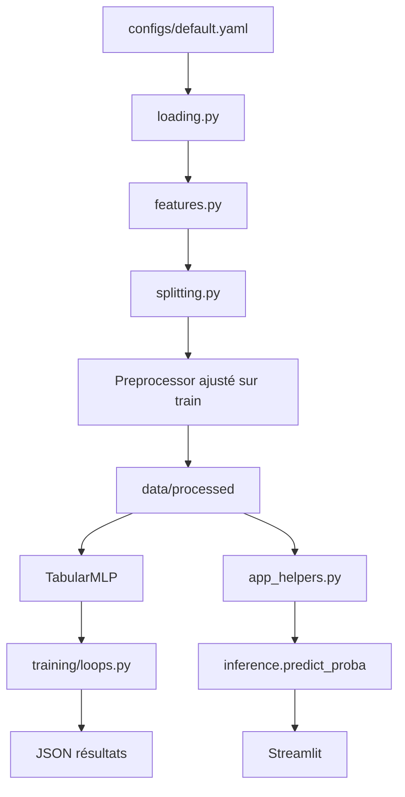

# Architecture détaillée

## 1. Inventaire des dossiers

| Dossier | Rôle |
|---|---|
| `configs/` | Paramètres YAML source, cible, modèle, entraînement et expériences |
| `data/raw/` | CSV locaux non versionnés des deux datasets |
| `data/processed/` | Splits NumPy et métadonnées générés |
| `src/ddos_tl/` | Package métier réutilisable |
| `scripts/` | Points d'entrée préparation, entraînement, audit et export |
| `notebooks/` | Exploration et comparaison exploratoires |
| `models/` | Checkpoints et métadonnées de modèles |
| `reports/results/` | Résultats tabulaires, JSON et rapports |
| `reports/figures/` | Visualisations générées |
| `app/` | Interface Streamlit |
| `tests/` | Tests unitaires et intégration |
| `docs/` | Documentation technique et scientifique |

## 2. Modules Python

| Fichier | Responsabilité | Entrées | Sorties |
|---|---|---|---|
| `config.py` | Charger/fusionner YAML et résoudre les chemins | YAML | dictionnaire de configuration |
| `inference.py` | Choisir le device et calculer `predict_proba`/`predict` | modèle, matrice X | probabilités ou indices |
| `app_helpers.py` | Valider CSV, transformer, construire exports et métriques | DataFrame, preprocessor, probabilités | tables et diagnostics |
| `data/loading.py` | Lire, nettoyer et mapper les CSV | répertoires CSV | DataFrames nettoyés |
| `data/features.py` | Mapper les noms et sélectionner les 76 features | colonnes source/cible | DataFrame aligné |
| `data/preprocessing.py` | Imputer, standardiser, clipper et encoder | DataFrame | matrice float32 / labels |
| `data/splitting.py` | Split stratifié, split par fichier et sous-échantillonnage | DataFrame/labels | indices ou partitions |
| `data/pipeline.py` | Orchestrer préparation, validation et sérialisation | config, DataFrames | splits et metadata |
| `data/synthetic.py` | Générer les données synthétiques de test | répertoires, seed | CSV synthétiques |
| `models/mlp.py` | Définir le MLP, backbone, tête et gel des blocs | dimensions, hidden, dropout | `TabularMLP` |
| `training/loops.py` | DataLoader contrôlé, poids de classes et boucle d'apprentissage | modèle, loaders, config | historique et meilleur état |
| `training/strategies.py` | Implémenter les cinq stratégies | données, config, seed | résultats d'une stratégie |
| `evaluation/metrics.py` | Accuracy, précision/rappel/F1, matrice | y vrai/prédit | dictionnaire de métriques |
| `evaluation/plots.py` | Tracer les matrices de confusion | matrice, noms | figure/fichier |
| `evaluation/results_analysis.py` | Auditer et résumer les runs | CSV/JSON | tableaux statistiques |
| `experiments/two_by_two.py` | Construire grille, initialisations et entrées partagées | data, config | contexte contrôlé |
| `experiments/runner.py` | Valider, exécuter ou simuler le manifeste 2×2 | manifeste, config | JSON isolés |
| `tuning/search.py` | Encapsuler la recherche Optuna | stratégie, données | meilleur essai |
| `utils/io.py` | JSON compatible NumPy | objets Python | fichiers JSON |
| `utils/seed.py` | Fixer les seeds | entier | état RNG déterministe |

## 3. Scripts

| Script | Usage |
|---|---|
| `prepare_data.py` | Préparer source et cible, rapports de données et splits |
| `pretrain.py` | Entraîner le backbone source binaire |
| `run_transfer.py` | Lancer un run cible par stratégie, fraction et seed |
| `run_experiments.py` | Lancer la grille historique avec reprise |
| `prepare_2x2_experiment.py` | Produire le manifeste contrôlé |
| `run_2x2_experiment.py` | Dry-run ou exécution des 48 configurations |
| `analyze_results.py` | Agréger les résultats généraux |
| `plot_results.py` | Produire figures et résumé |
| `final_audit.py` | Auditer les 108 résultats |
| `statistical_validation.py` | Recalculer IC et contrastes appariés |
| `export_final_model.py` | Entraîner/exporter le modèle final avec `--execute` explicite |
| `evaluate_final_model.py` | Évaluer le checkpoint final sur le test |
| `make_synthetic_data.py` | Générer le jeu synthétique de validation |

## 4. Flux d'entraînement et d'inférence

## 5. Artefacts

- `models/pretrained_checkpoint.pt` : checkpoint source binaire.
- `models/pretrained_backbone.pt` : backbone source.
- `models/best_model.pt` : modèle cible final à 18 sorties.
- `models/best_meta.json` : architecture, 76 features, 18 classes,
  preprocessing, seed, métriques et hash.
- `reports/results/experiments.csv` et `runs/` : 60 runs historiques.
- `reports/results/phase_2x2_scaler_initialization/` : 48 runs contrôlés.

