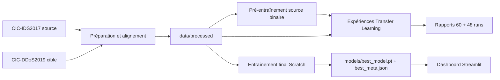

# Vue d'ensemble du projet

## 1. Objet

Ce projet étudie la classification multiclasses de flux réseau DDoS par
réseau de neurones et Transfer Learning. Le dataset source est CIC-IDS2017
et le dataset cible est CIC-DDoS2019. Le modèle final est un MLP entraîné
sur le domaine cible avec 76 variables d'entrée et 18 classes de sortie.

L'objectif scientifique initial était de mesurer si un backbone pré-entraîné
sur une tâche source binaire pouvait aider une classification cible
multiclasse, notamment lorsque peu de données annotées sont disponibles.

## 2. Périmètre réellement vérifié

- Préparation documentée des données source et cible.
- Alignement sémantique vers 76 features numériques.
- Pré-entraînement source binaire (`BENIGN=0`, `DDoS=1`).
- Grille historique de 60 runs.
- Expérience contrôlée 2×2 de 48 runs.
- Audit statistique des 108 runs.
- Modèle final Scratch, 18 classes, exporté dans `models/`.
- Application Streamlit et tests d'inférence.

Les datasets locaux sont des miroirs fournis localement ; leur provenance
amont n'a pas été vérifiée indépendamment. Cette limite est importante pour
la reproductibilité externe.

## 3. Modèle final

| Élément | Valeur |
|---|---|
| Domaine | CIC-DDoS2019 |
| Stratégie | Scratch |
| Architecture | `76 → 256 → 128 → 64 → 18` |
| Fraction | 100 % du train cible |
| Seed exportée | 0 |
| Meilleure époque | 20 |
| Macro F1 validation | 0.474940 |
| Macro F1 test | 0.468371 |
| Preprocessing | médiane, standardisation, clipping `[-10, 10]` |

Le choix Scratch ne prouve pas que le Transfer Learning est inutile en
général. Il correspond au meilleur protocole de validation retenu dans ce
repository, avec les limites du split, des seeds et du domain shift.

## 4. Architecture générale

## 5. Limites

Le split principal est aléatoire par lignes. Des flux proches peuvent donc
se retrouver dans plusieurs partitions. Les classes `UDPLag` et `WebDDoS`
ont un support test de 8 exemples dans l'évaluation finale. Le dashboard est
un outil d'analyse et non un système de protection réseau temps réel.

