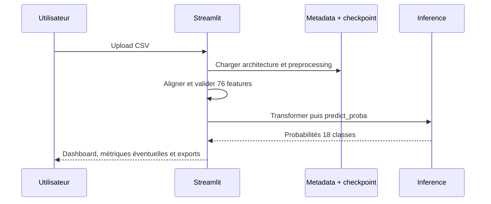

# Application Streamlit

## 1. Rôle

L'application transforme un CSV de flux réseau avec le même preprocessing que
le modèle final, calcule une prédiction sur 18 classes et expose les résultats
dans un dashboard. Elle ne contient aucun appel d'entraînement et n'ajuste
jamais le scaler sur les données importées.

## 2. Chargement

`app/streamlit_app.py` :

1. charge `models/best_meta.json` ;
2. vérifie 76 features et 18 classes ;
3. construit `TabularMLP` selon `meta["arch"]` ;
4. charge `models/best_model.pt` avec `weights_only=True` ;
5. restaure `Preprocessor` depuis les statistiques sérialisées.

`src/ddos_tl/inference.py` met le modèle en mode évaluation, traite les
exemples par lots, applique softmax et renvoie une matrice `(n, 18)`.

## 3. Import et validation

Les helpers de `src/ddos_tl/app_helpers.py` :

- lisent le CSV sans supprimer silencieusement les lignes ;
- refusent un fichier vide ou dépassant la limite configurée ;
- appliquent l'alignement sémantique cible ;
- signalent les colonnes absentes ;
- convertissent les valeurs invalides en valeurs imputables par le
  preprocessor sauvegardé ;
- vérifient que les probabilités sont finies et normalisées.

La confidence affichée est la probabilité maximale. Elle n'est pas une
probabilité calibrée au sens statistique.

## 4. Dashboard et exports

Le dashboard affiche :

- état du modèle, stratégie, architecture, nombre de features/classes ;
- flows totaux, Benign, DDoS, classes distinctes et confiance moyenne ;
- distributions, top 5 et niveaux de confiance ;
- recherche, filtrage, tri et tableau de prédictions ;
- CSV de prédictions ;
- CSV des probabilités des 18 classes.

Si une colonne `Label` est présente, les métriques sont calculées uniquement
pour les labels connus. Un label absent ou inconnu ne devient jamais une
vérité terrain fabriquée. Un rapport JSON est disponible lorsque l'évaluation
est possible.

## 5. Diagramme

## 6. Vérifications et limites

La suite complète compte 47 tests et le module compile. Le smoke test HTTP
de `/_stcore/health` a répondu `200 ok`. Une interaction navigateur complète
et un test réel CSV persistant ne sont pas établis par un artefact séparé ;
ils restent à vérifier avant une démonstration finale.

